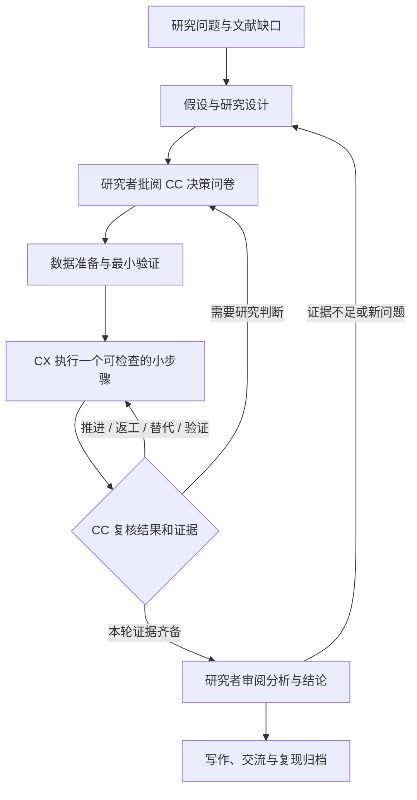

# 科研牛马局 · Research Niuma Lab

**你负责研究判断，CC 当导师，CX 们干活。**  
**You lead the research. Claude Code mentors. Codex agents do the work.**

A local research workbench for **Claude Code (CC) × Codex (CX)**, with Markdown handoffs, human decisions, and a visible feedback loop.

[中文介绍](#中文介绍) · [English](#english) · [科研流程 / Research workflow](RESEARCH-WORKFLOW.md) · [Privacy & security](SECURITY.md) · [MIT License](LICENSE)

> “牛马” is a playful Chinese internet expression for tireless workers. Here, the AI agents take that role. The application is an independent community project and is not affiliated with Anthropic or OpenAI.

> `main` 分支现已包含 Claude Code 对话主页和实验区。下方 v0.4.0 安装包仍是上一稳定版；要使用新界面，请按「从源码启动」运行。
> The `main` branch includes the Claude Code chat home and the Experiments workspace. The v0.4.0 installers below are the previous stable build; use the source quick start for the new interface.

## 下载安装 / Download

**[GitHub Releases · v0.4.0](https://github.com/Hbw1201/research-niuma/releases/tag/v0.4.0)** · [最新版本 / Latest release](https://github.com/Hbw1201/research-niuma/releases/latest)

| 系统 / Platform | 直接下载 / Direct download | 安装 / Install |
|---|---|---|
| Windows x64 | [EXE installer](https://github.com/Hbw1201/research-niuma/releases/download/v0.4.0/Relay-Lab-Setup-0.4.0-x64.exe) | 运行安装向导 / Run the installer |
| macOS Apple Silicon · M 系列 | [ARM64 DMG](https://github.com/Hbw1201/research-niuma/releases/download/v0.4.0/Relay-Lab-0.4.0-macos-arm64.dmg) | 拖入 Applications / Drag into Applications |
| macOS Intel | [x64 DMG](https://github.com/Hbw1201/research-niuma/releases/download/v0.4.0/Relay-Lab-0.4.0-macos-x64.dmg) | 拖入 Applications / Drag into Applications |
| Ubuntu / Debian x64 | [DEB package](https://github.com/Hbw1201/research-niuma/releases/download/v0.4.0/Relay-Lab-0.4.0-linux-x64.deb) | `sudo apt install ./Relay-Lab-0.4.0-linux-x64.deb` |
| Linux x64 portable | [AppImage](https://github.com/Hbw1201/research-niuma/releases/download/v0.4.0/Relay-Lab-0.4.0-linux-x64.AppImage) | 赋予执行权限后运行 / Make executable, then run |
| 跨平台终端 / CLI · Node.js 22+ | [npm tarball](https://github.com/Hbw1201/research-niuma/releases/download/v0.4.0/relay-lab-0.4.0.tgz) | `npm install -g ./relay-lab-0.4.0.tgz` |

桌面包自带运行时，无需另装 Node.js。Claude Code 和 Codex 需要自行安装并登录。AppImage 在部分 Linux 系统需要 FUSE 2 兼容库，也可选择 DEB。

Desktop packages include their runtime. Install and authenticate Claude Code and Codex separately. Some Linux systems need FUSE 2 compatibility libraries for AppImage; DEB is an alternative.

**签名状态 / Signing:** Windows 没有发布者签名；macOS 采用 ad-hoc 签名，没有 Apple Developer ID 或公证，首次运行可能被系统提示或拦截。Windows has no publisher signature; macOS is ad-hoc signed without Developer ID or notarization, so the OS may warn or block first launch.

[SHA-256 校验值 / Checksums](https://github.com/Hbw1201/research-niuma/releases/download/v0.4.0/SHA256SUMS.txt) · [构建与包内文件记录 / Build manifest](https://github.com/Hbw1201/research-niuma/releases/download/v0.4.0/BUILD-INFO.json)

发布包仅从公开源码在干净的 GitHub 托管环境构建，不包含开发者的密钥、CLI 登录信息、课题数据或历史记录。Release packages are built from public source on clean GitHub-hosted runners, without developer credentials, CLI login, research data, or local history.

## 中文介绍

科研牛马局是一个在本机运行的科研协作工作台，提供网页、终端 CLI 和 Electron 桌面入口。每个课题拥有独立的文件夹、研究计划、规则和团队：一位 CC 导师管理多个 CX 执行者，以 Markdown 文档持续交接。

目标是让你看得见 AI 正在做什么、为什么继续或重做，并在关键研究决策上保持控制。界面采用深色终端风格和等宽字体。目前产品界面主要为中文，可设置 AI 输出语言。

### 能做什么

- **主页对话：** 在主页直接与本机 Claude Code 对话，查看流式回复，停止生成或恢复先前从主页创建的对话。这里的聊天独立于课题。
- **实验区：** 从主页进入实验区，按课题查看协作、研究流程、团队和文件。在课题各页都可以打开 CC 对话框，询问当前进展或补充研究要求。
- **课题技能：** 在「研究团队 → 共用技能」勾选技能，按中文名称、用途或英文标识搜索。译名仅用于显示，不改变实际加载的技能或课题已有的选择。
- **从 idea 开始：** 新建页面先填写标题、选择本地文件夹，再与 CC 讨论。CC 追问、澄清目标，提出方向和研究计划，由研究者确认。
- **先讨论再执行：** CC 可以组织创新、方法、实验、质疑四个视角的讨论，生成决策问卷。研究者逐项批阅后，才将获批范围交给 CX。
- **持续反馈：** CX 回报结果或阻塞，CC 复核证据并安排下一步、返工、替代方案、交叉验证，或请求研究者判断。用户可在协作过程中补充观察和提问。
- **可展开的 Pipeline：** 查看真实任务、依赖、反馈与分支，点击节点查看理由、证据和交接文档；保留失败尝试与阴性结果。
- **CC Leader / Auto Research：** 新课题默认由 CC 自主组织团队。你确认目标和首轮问卷后，CC 决定 CX 数量、职责、模型、语言与技能；每次回报后重新评估配置，必要时扩缩编、改派或取消过时待办，待办清空后检查全项目目标并自动推进后续实验、分析或写作。
- **用户可控的团队：** 活跃 CX 上限可设 1–32，项目并发上限可设 1–16，实际并发还受工作区上限约束。可固定某个 CX 的配置；运行中的成员不会被改配，归档成员保留会话、产物和 tokens。旧课题保留原模式，可在「团队 → CC Leader」启用 Auto Research。
- **模型与用量：** CC、每个 CX 可选择模型；动态模型在任务之间选择；模型列表留空时读取本机模型目录，填写时只使用该列表。按真实 CLI 报告统计 CC/CX、课题、会话和调用的 token，缺失值不估算。
- **本机工作区：** 读取工作区规则和所选技能，保存任务、报告和决策 Markdown；扫描本机 CLI、相关进程和有限的近期会话索引。

### 科研流程



应用将研究组织为八个可往返阶段：**研究问题 → 文献与缺口 → 假设与设计 → 数据准备 → 最小验证与基线 → 正式实验与迭代 → 分析与结论复核 → 写作、交流与归档**。这是面向实证和计算研究的工作框架，不是所有学科的固定顺序。

程序退出成功、CC 验收任务、研究者确认科研阶段是不同状态。完整说明与参考来源见 [RESEARCH-WORKFLOW.md](RESEARCH-WORKFLOW.md)。

### 从源码启动

需要 **Node.js 22+**，以及你自己安装并配置好的 Claude Code 和 Codex CLI。应用沿用各 CLI 的认证和模型配置；仓库不附带 API key、账号或模型额度，真实模型调用可能产生费用。

网页与 CLI 核心没有第三方运行时依赖，克隆后可直接运行：

```sh
git clone https://github.com/Hbw1201/research-niuma.git
cd research-niuma
node bin/relay-lab.mjs start --workspace /absolute/path/to/research --open
```

Windows PowerShell 示例：

```powershell
node .\bin\relay-lab.mjs start --workspace "D:\Research" --open
```

macOS / Ubuntu 示例：

```sh
sh start-unix.sh "$HOME/Research"
```

启动后先打开对话主页。要开展课题，进入「实验区」，在设置中检查本机 CLI，再新建课题，与 CC 讨论目标并确认问卷。

其他终端入口：

```sh
node bin/relay-lab.mjs --help
node bin/relay-lab.mjs scan
node bin/relay-lab.mjs status --workspace /absolute/path/to/research
```

也可以自行打包并安装 CLI：

```sh
npm pack
npm install -g ./relay-lab-0.5.0.tgz
relay-lab start --workspace /absolute/path/to/research
```

### 桌面版与开发

```sh
npm ci
npm test
npm run desktop
# 在对应操作系统构建
npm run dist:win
npm run dist:mac
npm run dist:linux
```

技术包名、终端命令和部分产物名仍为 `relay-lab` / `Relay Lab`。桌面版默认使用用户文档目录下的 `Relay Lab`，也支持通过 `RELAY_WORKSPACE` 指定工作区。

Windows 桌面与真实 CLI 反馈链路已做本机验证。发布流水线在 Windows、macOS Apple Silicon / Intel、Ubuntu 上分别构建，检查包内源码、内置 CLI 和空工作区本地服务；完整安装向导与桌面交互仍需在用户设备上验证。签名状态见上方下载说明。构建产物位于 GitHub Releases，不提交进源码仓库。

### 数据与边界

- 工作区索引保存在 `<workspace>/.relay-lab/`；课题文档、运行记录和产物保存在所选课题目录的 `.relay-lab/projects/<id>/`。
- **本地存储不等于离线推理。** 启动真实任务时，提示词、所选规则/Skills 和 CLI 读取的内容会交给用户配置的模型服务。请只给任务访问适合该服务处理的材料。
- 默认只监听 `127.0.0.1`。这是本机工具，不是面向公网的多用户服务。
- 发现外部终端不等于接管终端。不会自动终止外部进程或注入键盘输入；已有会话恢复或队列交接取决于 CLI 版本和能力。
- 反馈在可检查的小步骤完成或阻塞后发生；工具日志实时显示。Auto Research 默认每轮最多 100 次 CC 复核，可设置 1–1000 次，到限保留进度并暂停；这是复核次数限制，不是金额封顶。
- 所选技能会加入实际输入并记录来源与哈希。界面优先读取技能文件头的 `name_zh`、`description_zh`；若工作区的 `.relay-lab/skills.zh-CN.json` 提供译文，则优先使用该译文。词典格式为 `{"example-skill":{"name":"示例技能","description":"说明用途"}}`。没有译文时显示原文，加载过程不需要调用翻译服务。
- 重启后未完成任务标为中断，不自动重新执行。科学结论和关键阶段最终由研究者确认。

发布隐私约定和源码检查方式见 [SECURITY.md](SECURITY.md)。

## English

Research Niuma Lab is a local research workbench with a web interface, a terminal CLI, and an Electron desktop entry point. Each project has its own directory, rules, research plan, and team. **One Claude Code mentor (CC) coordinates multiple Codex workers (CX), exchanging tasks and reports through Markdown.**

It makes the research process inspectable: what each agent is doing, what evidence it produced, why a step was repeated, and where human judgment is needed. The UI uses a dark terminal style and monospace text. It is currently primarily Chinese; agent output language is configurable.

### Features

- **Chat home:** talk directly to your local Claude Code CLI, stream replies, stop generation, or resume a conversation started from the home page. These chats are separate from project instructions.
- **Experiments:** open a project to inspect its collaboration, pipeline, team, and files. The project chat is available across views for questions and changes to research requirements.
- **Project skills:** select shared skills in Team, and search by Chinese name, purpose, or original identifier. Display translations do not change the skill that runs or any saved selections.
- **Idea clarification:** choose a title and local folder, discuss the idea with CC, and confirm the proposed direction and research plan.
- **Human decisions before execution:** CC can discuss novelty, methods, experiments, and criticism through four perspectives, then draft a questionnaire for the researcher to review.
- **Continuous feedback:** a CX returns evidence or a blocker; CC reviews it and proposes the next step, a revision, an alternative, independent verification, or a human decision. The researcher can send observations and questions throughout.
- **Inspectable Pipeline:** actual task and review nodes retain dependencies, decisions, failed attempts, and Markdown handoffs. Click a node to inspect the evidence.
- **Auto Research:** new projects default to a CC Leader that chooses the team size, responsibilities, models, language, and Skills after initial scope approval. It reassesses the team after results, archives idle workers without losing history, revises queued assignments and priorities, cancels obsolete work, and checks the overall goal before moving into further experiments, analysis, or writing.
- **User controls:** configure up to 32 active workers and 16 concurrent executions, subject to the workspace limit. Pin individual workers to preserve their configuration. Existing projects retain their previous mode until Auto Research is enabled in Team. The default review limit is 100 per run, configurable from 1 to 1000; it is not a monetary cap.
- **Models and usage:** choose CC/CX models, allow CC to choose models between tasks from the local model catalog or an explicit user list, and track tokens reported by the CLIs. Missing usage is marked rather than estimated.
- **Local workspaces:** project rules, explicit Skill loading, CLI/process discovery, bounded recent-session discovery, and persistent task/report/decision files.

### Research, not just task execution

The workbench organizes empirical and computational research into eight revisitable stages:

**Question → Literature and gap → Hypothesis and design → Data preparation → Pilot and baseline → Experiments and iteration → Analysis and conclusion review → Writing, communication, and reproducibility.**

A process exiting successfully, CC accepting a task, and a researcher accepting a scientific conclusion are separate events. Negative results remain part of the record. Disciplines such as theoretical or qualitative research need suitable adaptations. See the [research workflow guide](RESEARCH-WORKFLOW.md), currently in Chinese.

### Quick start

Install **Node.js 22+** and independently install/authenticate Claude Code and Codex. The application uses your local CLI configuration; it does not include credentials or model access. Model calls may incur charges from your configured provider.

```sh
git clone https://github.com/Hbw1201/research-niuma.git
cd research-niuma
node bin/relay-lab.mjs start --workspace /absolute/path/to/research --open
```

The web/CLI core has no third-party runtime dependencies, so this command does not require `npm install`. On Windows, use a path such as `"D:\Research"`; on macOS/Linux, use a directory under your home folder. The server opens on the chat home. Enter Experiments to check CLI detection in Settings, create a project, discuss the idea, and review the questionnaire before execution.

For the desktop application, run `npm ci` followed by `npm run desktop`. Build with `npm run dist:win`, `npm run dist:mac`, or `npm run dist:linux` on the corresponding OS. The command/package name remains `relay-lab`.

Windows desktop and a real CC/CX feedback loop have been exercised locally. Release builds run on Windows, Apple Silicon/Intel macOS, and Ubuntu, with packaged-source, bundled-CLI, and fresh local-service checks. Full manual installer and desktop interaction testing on user devices remains separate. See the signing status above. Installers are available through [GitHub Releases](https://github.com/Hbw1201/research-niuma/releases/latest).

### Privacy and operational limits

Project data is stored under local `.relay-lab` directories and excluded from this source repository. **Local storage does not mean offline inference:** prompts, selected rules/Skills, and material read by the CLIs may be sent to the model provider configured by the user. The server listens on loopback and is intended for a single local operator.

External terminal discovery is not transparent terminal takeover. Feedback is exchanged after bounded, inspectable steps; logs stream during execution. The default automatic CC review limit is 100 per run, configurable from 1–1000; it is not a monetary spending cap. Interrupted tasks are not silently restarted. Human researchers remain responsible for study design, evidence interpretation, and final claims.

### Tests and contributions

```sh
node --test tests/*.test.mjs
node scripts/check-public-source.mjs
```

The test suite covers review gates, task scope checks, concurrency, persistent sessions, cancellation and recovery, model/Skill configuration, usage accounting, HTTP restrictions, and the feedback loop. Automated model responses are isolated fixtures, not fabricated research results. Tests do not require real API keys.

Issues and pull requests are welcome. Use synthetic examples, and remove credentials, private research, session IDs, local histories, and personal paths from shared logs or screenshots. See [SECURITY.md](SECURITY.md).

## License / 许可

[MIT](LICENSE). Claude Code, Codex, their services, and third-party Skills remain subject to their respective licenses and terms.
