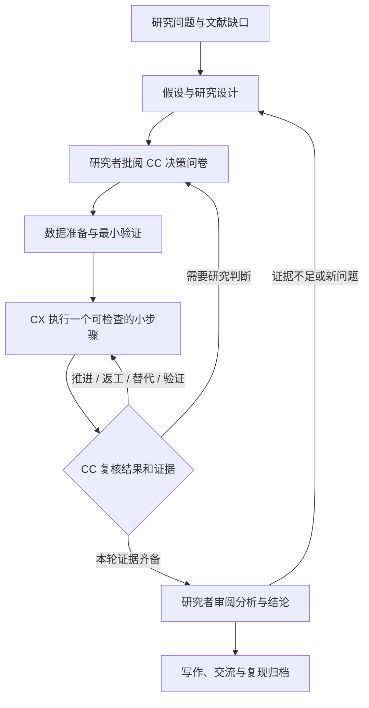

# 科研牛马局 · Research Niuma Lab

**你负责研究判断，CC 当导师，CX 们干活。**  
**You lead the research. Claude Code mentors. Codex agents do the work.**

A local research workbench for **Claude Code (CC) × Codex (CX)**, with Markdown handoffs, human decisions, and a visible feedback loop.

[中文介绍](#中文介绍) · [English](#english) · [科研流程 / Research workflow](RESEARCH-WORKFLOW.md) · [Privacy & security](SECURITY.md) · [MIT License](LICENSE)

> “牛马” is a playful Chinese internet expression for tireless workers. Here, the AI agents take that role. The application is an independent community project and is not affiliated with Anthropic or OpenAI.

## 中文介绍

科研牛马局是一个在本机运行的科研协作工作台，提供网页、终端 CLI 和 Electron 桌面入口。每个课题拥有独立的文件夹、研究计划、规则和团队：一位 CC 导师管理多个 CX 执行者，以 Markdown 文档持续交接。

目标是让你看得见 AI 正在做什么、为什么继续或重做，并在关键研究决策上保持控制。界面采用深色终端风格和等宽字体。目前产品界面主要为中文，可设置 AI 输出语言。

### 能做什么

- **按项目组织：** 左栏是课题，项目内分为协作、Pipeline、团队、文件；主内容区独立滚动。
- **从 idea 开始：** 新建页面先填写标题、选择本地文件夹，再与 CC 讨论。CC 追问、澄清目标，提出方向和研究计划，由研究者确认。
- **先讨论再执行：** CC 可以组织创新、方法、实验、质疑四个视角的讨论，生成决策问卷。研究者逐项批阅后，才将获批范围交给 CX。
- **持续反馈：** CX 回报结果或阻塞，CC 复核证据并安排下一步、返工、替代方案、交叉验证，或请求研究者判断。用户可在协作过程中补充观察和提问。
- **可展开的 Pipeline：** 查看真实任务、依赖、反馈与分支，点击节点查看理由、证据和交接文档；保留失败尝试与阴性结果。
- **可配置团队：** 每个课题可配置 1–8 个 CX，讨论和确认分工、模型、输出语言、共用及专用 Skills。执行并发另受工作区上限约束。
- **模型与用量：** CC、每个 CX 可选择模型；可选的动态模型策略只在用户允许的模型列表内、在任务之间生效。按真实 CLI 报告统计 CC/CX、课题、会话和调用的 token，缺失值不估算。
- **本机工作区：** 读取工作区规则和所选 Skills，保存任务、报告和决策 Markdown；扫描本机 CLI、相关进程和有限的近期会话索引。

### 科研流程



应用将研究组织为八个可往返阶段：**研究问题 → 文献与缺口 → 假设与设计 → 数据准备 → 最小验证与基线 → 正式实验与迭代 → 分析与结论复核 → 写作、交流与归档**。这是面向实证和计算研究的工作框架，不是所有学科的固定顺序。

程序退出成功、CC 验收任务、研究者确认科研阶段是不同状态。完整说明与参考来源见 [RESEARCH-WORKFLOW.md](RESEARCH-WORKFLOW.md)。

### 从源码启动

需要 **Node.js 22+**，以及你自己安装并配置好的 Claude Code 和 Codex CLI。应用沿用各 CLI 的认证和模型配置；仓库不附带 API key、账号或模型额度，真实模型调用可能产生费用。

网页与 CLI 核心没有第三方运行时依赖，克隆后可直接运行：

```sh
git clone https://github.com/Hbw1201/research-niuma.git
cd research-niuma
node bin/relay-lab.mjs start --workspace /absolute/path/to/research --open
```

Windows PowerShell 示例：

```powershell
node .\bin\relay-lab.mjs start --workspace "D:\Research" --open
```

macOS / Ubuntu 示例：

```sh
sh start-unix.sh "$HOME/Research"
```

进入「设置与本机连接」核对 CLI 识别结果，必要时手动指定可执行文件。然后新建课题，与 CC 讨论、确认团队和问卷，再启动执行。

其他终端入口：

```sh
node bin/relay-lab.mjs --help
node bin/relay-lab.mjs scan
node bin/relay-lab.mjs status --workspace /absolute/path/to/research
```

也可以自行打包并安装 CLI：

```sh
npm pack
npm install -g ./relay-lab-0.4.0.tgz
relay-lab start --workspace /absolute/path/to/research
```

### 桌面版与开发

```sh
npm ci
npm test
npm run desktop
# 在对应操作系统构建
npm run dist:win
npm run dist:mac
npm run dist:linux
```

技术包名、终端命令和部分产物名仍为 `relay-lab` / `Relay Lab`。桌面版默认使用用户文档目录下的 `Relay Lab`，也支持通过 `RELAY_WORKSPACE` 指定工作区。

Windows 桌面与真实 CLI 反馈链路已做本机验证。仓库包含 Windows、macOS、Ubuntu 的构建配置；macOS / Linux 原生运行尚待实机验证，不代表已经支持所有环境。未配置代码签名或 Apple 公证。构建产物不提交进源码仓库。

### 数据与边界

- 工作区索引保存在 `<workspace>/.relay-lab/`；课题文档、运行记录和产物保存在所选课题目录的 `.relay-lab/projects/<id>/`。
- **本地存储不等于离线推理。** 启动真实任务时，提示词、所选规则/Skills 和 CLI 读取的内容会交给用户配置的模型服务。请只给任务访问适合该服务处理的材料。
- 默认只监听 `127.0.0.1`。这是本机工具，不是面向公网的多用户服务。
- 发现外部终端不等于接管终端。不会自动终止外部进程或注入键盘输入；已有会话恢复或队列交接取决于 CLI 版本和能力。
- 反馈在可检查的小步骤完成或阻塞后发生；工具日志实时显示。每轮默认最多 8 次自动 CC 复核，界面可设置 1–30 次，到限暂停；不是金额封顶。
- 所选 Skills 会加入实际输入并记录来源与哈希；不替换 CLI 原有配置，也不是对所有原生工具的强隔离。
- 重启后未完成任务标为中断，不自动重新执行。科学结论和关键阶段最终由研究者确认。

发布隐私约定和源码检查方式见 [SECURITY.md](SECURITY.md)。

## English

Research Niuma Lab is a local research workbench with a web interface, a terminal CLI, and an Electron desktop entry point. Each project has its own directory, rules, research plan, and team. **One Claude Code mentor (CC) coordinates multiple Codex workers (CX), exchanging tasks and reports through Markdown.**

It makes the research process inspectable: what each agent is doing, what evidence it produced, why a step was repeated, and where human judgment is needed. The UI uses a dark terminal style and monospace text. It is currently primarily Chinese; agent output language is configurable.

### Features

- **Project-based navigation:** a project sidebar with Collaboration, Pipeline, Team, and Files views.
- **Idea clarification:** choose a title and local folder, discuss the idea with CC, and confirm the proposed direction and research plan.
- **Human decisions before execution:** CC can discuss novelty, methods, experiments, and criticism through four perspectives, then draft a questionnaire for the researcher to review.
- **Continuous feedback:** a CX returns evidence or a blocker; CC reviews it and proposes the next step, a revision, an alternative, independent verification, or a human decision. The researcher can send observations and questions throughout.
- **Inspectable Pipeline:** actual task and review nodes retain dependencies, decisions, failed attempts, and Markdown handoffs. Click a node to inspect the evidence.
- **Configurable teams:** 1–8 CX workers per project, with confirmed responsibilities, models, output languages, and shared or worker-specific Skills. Execution is also constrained by workspace concurrency.
- **Models and usage:** choose CC/CX models, optionally allow CC to select among an approved model list between tasks, and track tokens reported by the CLIs. Missing usage is marked rather than estimated.
- **Local workspaces:** project rules, explicit Skill loading, CLI/process discovery, bounded recent-session discovery, and persistent task/report/decision files.

### Research, not just task execution

The workbench organizes empirical and computational research into eight revisitable stages:

**Question → Literature and gap → Hypothesis and design → Data preparation → Pilot and baseline → Experiments and iteration → Analysis and conclusion review → Writing, communication, and reproducibility.**

A process exiting successfully, CC accepting a task, and a researcher accepting a scientific conclusion are separate events. Negative results remain part of the record. Disciplines such as theoretical or qualitative research need suitable adaptations. See the [research workflow guide](RESEARCH-WORKFLOW.md), currently in Chinese.

### Quick start

Install **Node.js 22+** and independently install/authenticate Claude Code and Codex. The application uses your local CLI configuration; it does not include credentials or model access. Model calls may incur charges from your configured provider.

```sh
git clone https://github.com/Hbw1201/research-niuma.git
cd research-niuma
node bin/relay-lab.mjs start --workspace /absolute/path/to/research --open
```

The web/CLI core has no third-party runtime dependencies, so this command does not require `npm install`. On Windows, use a path such as `"D:\Research"`; on macOS/Linux, use a directory under your home folder. Check local CLI detection in Settings, create a project, discuss the idea, review the team and questionnaire, then start execution.

For the desktop application, run `npm ci` followed by `npm run desktop`. Build with `npm run dist:win`, `npm run dist:mac`, or `npm run dist:linux` on the corresponding OS. The command/package name remains `relay-lab`.

Windows desktop and a real CC/CX feedback loop have been exercised locally. Native macOS/Linux runtime validation is still pending. Cross-platform build workflows are provided; code signing and Apple notarization are not configured. This repository contains source rather than bundled desktop installers.

### Privacy and operational limits

Project data is stored under local `.relay-lab` directories and excluded from this source repository. **Local storage does not mean offline inference:** prompts, selected rules/Skills, and material read by the CLIs may be sent to the model provider configured by the user. The server listens on loopback and is intended for a single local operator.

External terminal discovery is not transparent terminal takeover. Feedback is exchanged after bounded, inspectable steps; logs stream during execution. The default automatic CC review limit is 8 per cycle, configurable from 1–30; it is not a monetary spending cap. Interrupted tasks are not silently restarted. Human researchers remain responsible for study design, evidence interpretation, and final claims.

### Tests and contributions

```sh
node --test tests/*.test.mjs
node scripts/check-public-source.mjs
```

The test suite covers review gates, task scope checks, concurrency, persistent sessions, cancellation and recovery, model/Skill configuration, usage accounting, HTTP restrictions, and the feedback loop. Automated model responses are isolated fixtures, not fabricated research results. Tests do not require real API keys.

Issues and pull requests are welcome. Use synthetic examples, and remove credentials, private research, session IDs, local histories, and personal paths from shared logs or screenshots. See [SECURITY.md](SECURITY.md).

## License / 许可

[MIT](LICENSE). Claude Code, Codex, their services, and third-party Skills remain subject to their respective licenses and terms.
