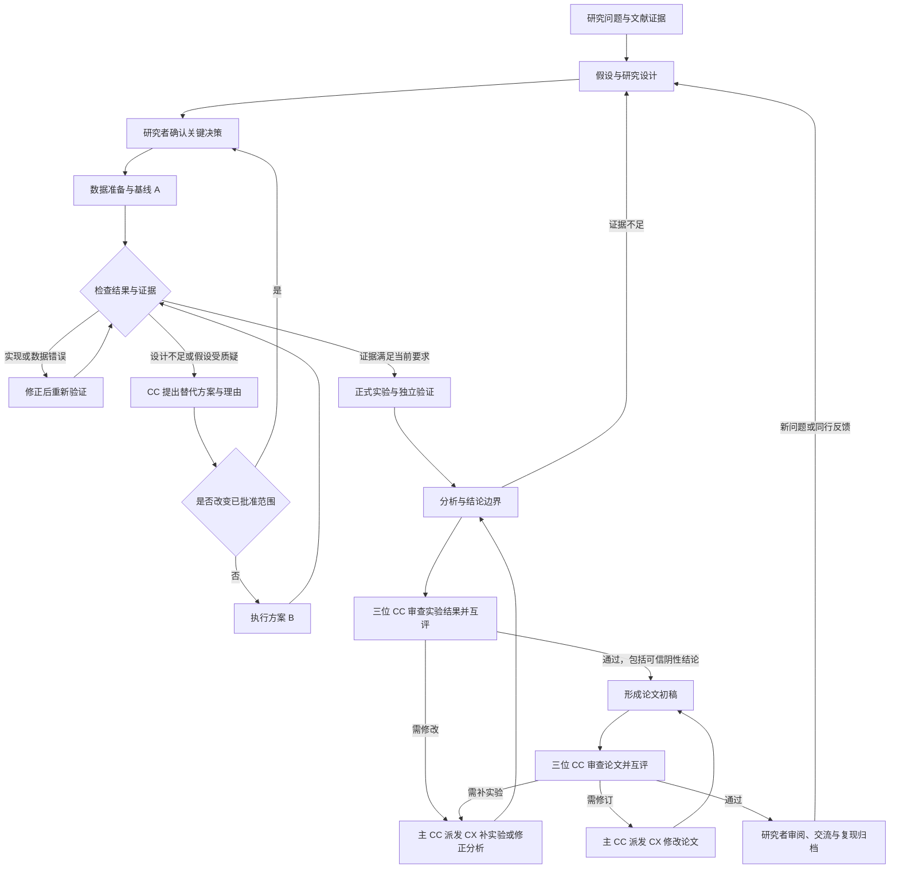

# 科研牛马局：科研流程与 AI 协作

这是面向实证、实验与计算研究的工作框架，不是所有学科通用的固定顺序。理论证明、质性研究和不同实验领域，需要替换相应的证据与验证环节。

科学研究通常是迭代的：已有知识引出问题，证据推动修订假设和设计，同行反馈也可能让研究返回先前环节。不是跑完一次实验就自然进入写论文。[National Academies《How Science Works》](https://www.ncbi.nlm.nih.gov/books/NBK621586/)

## 科研主线

| 阶段 | 要回答的问题 | 主要产出 | 进入下一步前的判断 |
|---|---|---|---|
| 1. 现象与研究问题 | 研究对象是什么？问题为何值得回答？范围多大？ | 问题陈述、概念定义、研究边界 | 能说明需要什么证据，而不只说“想做一个模型” |
| 2. 文献与缺口 | 已有什么答案？什么证据不足？与已有工作差在哪？ | 核验后的文献与方法对照、缺口和不确定性清单 | 把已有事实、未核实信息、自己的假设分清楚 |
| 3. 假设与研究设计 | 如何区分自己的解释与替代解释？什么会推翻假设？ | 可检验假设、研究方案、对照、指标、分析与停止规则 | 研究者确认问题、设计和资源范围；CC 将关键分歧整理为决策问卷 |
| 4. 数据与实验准备 | 数据和实验条件是否适合问题？如何防止测量偏差和泄漏？ | 数据来源与版本、质量审计、样本划分、环境与代码版本 | 材料可用，必要许可/伦理条件落实，分析单位与划分明确 |
| 5. 最小验证与基线 | 测量链条是否可靠？最小方法能否运行？研究设计可行吗？ | 小规模试验、基线、资源开销、失败分析 | 区分实现错误、数据问题、设计不足和假设不成立 |
| 6. 正式实验与迭代 | 核心主张是否被证据支持？改进到底来自哪里？ | 主实验、对照/消融、重复试验、完整日志和阴性结果 | 按确定的协议报告；改变方案时记录原因与版本 |
| 7. 分析与结论复核 | 结果的幅度和不确定性怎样？有无替代解释？适用边界是什么？ | 统计/误差分析、稳健性检查、结论—证据对照、复跑结果 | 研究者确认结论不超过证据；不把 CX 自报成功当作独立复现 |
| 8. 写作、交流与归档 | 如何让别人理解、检验并复用研究？ | 论文或报告、图表、复现说明、代码数据版本、同行回应 | 核对主张与引用，确认署名、披露与共享范围；反馈可触发补充实验 |

文献整理、实验日志和写作草稿可贯穿多个阶段，不必等到最后才开始。非预期或阴性结果也可能帮助排除解释；是否继续应由研究问题和证据决定，而不是一直修改到结果变好。

探索与验证要分开：根据已有结果产生新假设是正常探索；用独立或事先保留的证据验证，才能更有力地支持该假设。可在适合的课题中使用预注册或预分析计划，但不把预注册作为所有领域的强制要求。[Center for Open Science：Preregistration](https://www.cos.io/initiatives/prereg)

复现材料的可运行性与论文结论的可信度也是不同层次。代码、数据和说明应完整可用，而关键结果需要明确的验证证据。[ACM SIGSIM：Reproducibility and Artifact Evaluation](https://sigsim.acm.org/conf/pads/2026/blog/artifact-evaluation/)

## 在应用中如何协作

研究者负责研究判断和最终结论。CC 负责澄清问题、综合证据、提出方案、整理决策问卷、拆解小步骤、复核 CX 的回报和安排下一步。CX 负责检索整理、实现、数据检查、运行实验、分析和复现等获批工作。

1. 建立项目目录，与主导师 CC 澄清 idea。主导师起草 proposal，交给三位额外的 CC 评委，分别审查研究价值与创新、方法与证据、可行性与风险。三位评委各自启动独立会话，独立评审完成后续接自己的会话，对另外两位评委的意见逐条互评。主导师读取全部意见，逐条说明采纳、部分采纳、暂缓或不采纳的理由，形成详细修订稿与指导方向，保留分歧和未知事项。研究者确认修订稿后进入研究设计。这里是 AI 提案评审流程，不代表真实外部同行已经验证研究质量。
2. 主导师依据已确认修订稿、评审回应和未决问题生成决策问卷，不再重复四视角头脑风暴。研究者逐项批准、修改或否决，确定研究目标与资源边界。评委会初稿、三份独立评审、三份互评和主导师修订稿分别保存为 Markdown；可查看独立日志、每位评委用量以及项目 CC 总用量。暂停或失败不跳过审查，恢复时只补齐未完成步骤；提案或用户要求变化则开启新一轮，旧记录仍保留。旧版本已立项且没有实验任务的课题可手动提交评委会，原有方案与问卷先归档，修订后需重新确认；已有实验任务的旧课题继续保留原执行记录。
3. 研究者点击确认执行。Auto Research 中，CC Leader 自主确定 CX 数量、分工、模型和 Skills，随后下发小步骤 Markdown；多个 CX 在各自目录执行独立任务。辅助模式仍由研究者确认团队。
4. 每个 CX 完成或遇到错误后返回 Markdown：真实操作、命令、证据位置、指标、限制、需要其它 CX 回答的问题。CC 可以在其它 CX 仍工作时先复核已返回结果。
5. CC 根据证据选择：推进下一步、重试修正、安排替代方案、交给另一个 CX 独立验证，或者向研究者提问。CC 把共享发现和相关报告交给下一项 CX。
6. 反馈循环持续执行，CC 根据瓶颈和实际结果调整空闲 CX 的配置或扩缩编。常规方法调整、替代实验和阶段推进由 CC 自主决定；超出研究者明确批准的边界、需要新授权或无法自行获取必要材料时才提问。达到本轮复核次数时保留进度并暂停。运行中可随时发送补充意见，CC 在下一次复核读取。
7. 待办清空后，CC 再检查全项目目标：证据不足则安排下一阶段，目标达到或得到有意义的阴性结论才结束。研究者可随时审阅证据，记录“确认本阶段”或“返回此阶段继续研究”。AI 回合完成不会自动替研究者确认科研结论。

每个 CX 保持自己的会话；跨 CX 共享报告与只读产物路径。当前采用“返回一个可检查的小步骤 → 复核 → 再交接”的交互，不向正在运行的 CLI 强塞新指令。每个任务的工具输出仍实时显示。

提案之后，评委会还自动参与两个阶段交接：正式实验与分析的回报齐备后，审查实验结果；写作阶段的回报齐备后，审查论文初稿。每轮先固定送审回报快照，再由三位 CC 独立评审、交叉互评，主 CC 逐条处理意见并下发关联问题编号的 CX 修改任务。修改完成、主 CC 初核回报后，重新送审新版本。三位评委均认可且无待修改事项时，才通过该阶段评审；可靠阴性结果可以通过。结果未通过时不派发写作任务，论文通过后仍保留研究者的最终判断。修改涉及新实验时，结果评审会重新触发，论文也将结合更新后的证据再次审查。

Pipeline 中保留每轮材料、三份评审、三份互评、主导师决策及 CX 修改任务，并将修改回报连接到下一轮送审；提案评审同样展示。点击节点可查看意见、证据路径、Markdown、运行日志及用量。复审续接各评委自己的会话。一次完整评审包含 7 次 CC 评审/决策调用，计入本轮复核上限；不足以启动下一组评委时暂停并保存进度。调用失败、用户停止、重启、派工中断均不会被视为评审通过。研究要求或送审回报变化会产生新轮次，原记录保留。

## 失败与分支

原始 A、CC 的判断、B、验证步骤都作为独立节点保留，箭头说明为何推进、回退或替换。未执行的研究步骤只显示为计划，不编造“已完成”。旧版本任务保留在“历史未分类”中，避免按名称猜测科研阶段。

## 证据与记录约定

- AI 可辅助检索、整理、实现、图表和写作；研究问题、设计和核心结论由研究者理解并负责。
- 所有对外主张应逐项对照实际数据、操作和来源；不编造文献、数据、实验结果，不掩盖抄袭。
- 探索得到的新结果或事后方案调整需要明确标注。
- 投稿或共享前，研究者按目标机构/期刊要求核对署名和 AI 使用披露；应用不会自动投稿或公开材料。
- `30-task-*.md` 保存任务；`40-report-*.md` 保存 CX 回报；`60-collaboration.md` 保存持续交流；`61-review-request-*.md` / `62-feedback-*.md` 保存 CC 复核输入与判断；`69-cycle-*.md` 保存本轮结果；`70-research-decisions.md` 保存研究者阶段判断。

## 当前实现边界

应用记录并调度任务，不自动证明科学结论成立；CC 的证据检查能力取决于实际读取与运行结果。核心设计变更由 CC 提请研究者确认，服务端同时校验获批问题 ID 和团队范围；这不等于对自然语言科研范围的形式化证明。预算当前以自动复核次数控制，不是金额封顶；真实调用均统计 token。
